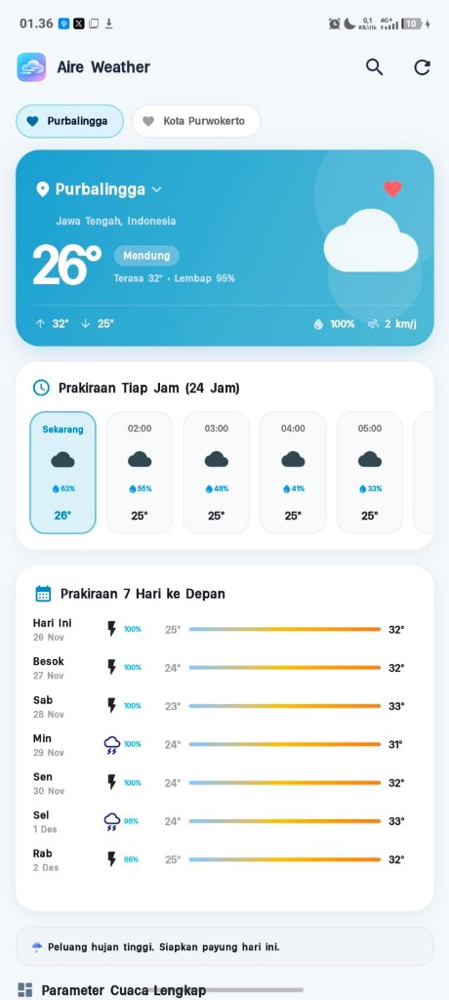
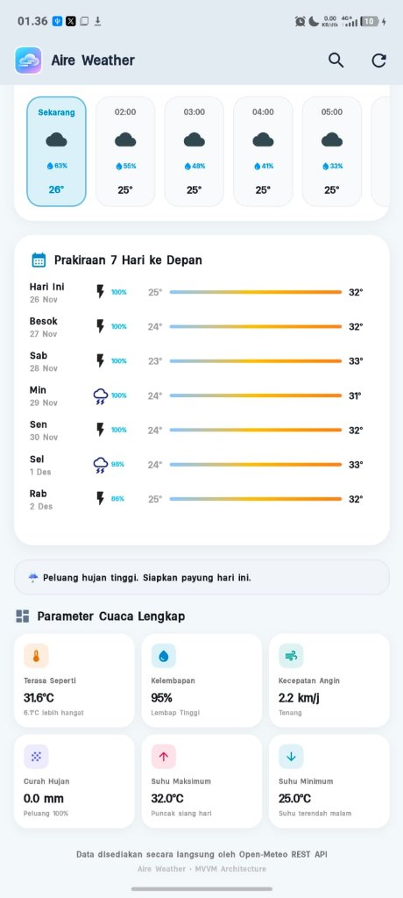
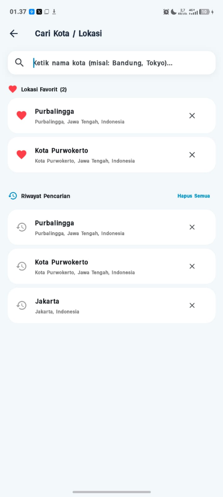
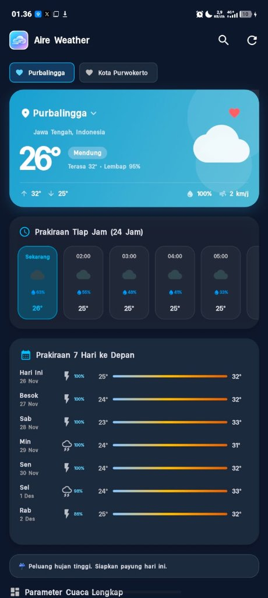
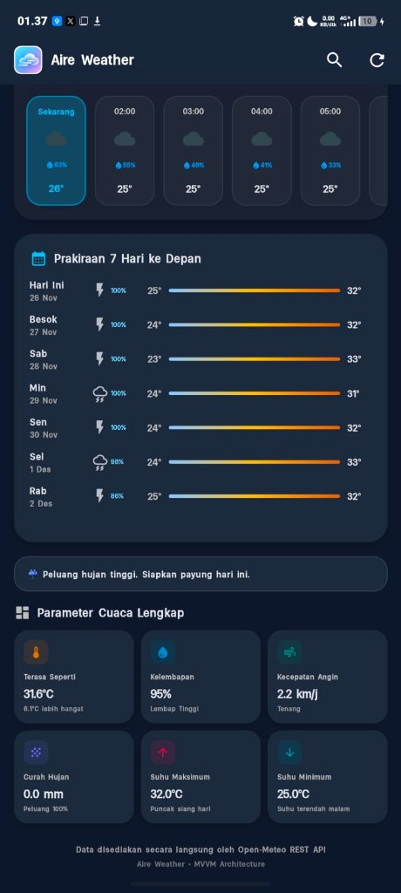
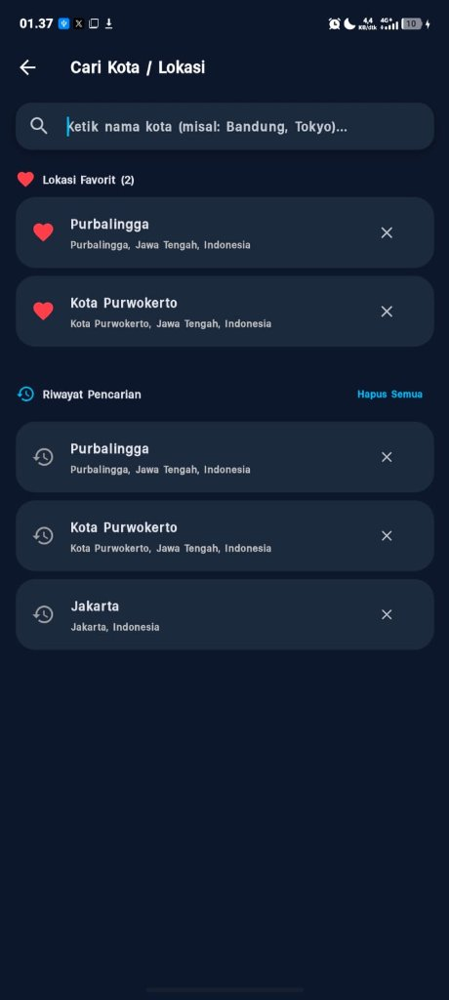

# Aire Weather - Aplikasi Prakiraan Cuaca (Responsi Flutter)

Aplikasi prakiraan cuaca berbasis **Flutter** yang menampilkan data cuaca terkini, prakiraan per jam, dan prakiraan 7 hari ke depan menggunakan **Open-Meteo REST API** dengan pola arsitektur **MVVM (Model-View-ViewModel)** serta penyimpanan lokal menggunakan **SharedPreferences**.

---

## Fitur Utama

### 1. Home / Weather Screen
- Menampilkan nama kota terpilih beserta wilayah/negara.
- Menampilkan kondisi cuaca terkini berdasarkan kode cuaca WMO (`current.weather_code`).
- Menampilkan suhu saat ini (`current.temperature_2m`).
- Menampilkan informasi cuaca tambahan:
  - Suhu yang dirasakan (`current.apparent_temperature`)
  - Kelembapan udara (`current.relative_humidity_2m`)
  - Kecepatan angin (`current.wind_speed_10m`)
  - Curah hujan (`current.precipitation`)
  - Suhu maksimum dan minimum harian (`daily.temperature_2m_max`, `daily.temperature_2m_min`)
  - Peluang hujan maksimum (`daily.precipitation_probability_max`)
- Menampilkan prakiraan cuaca per jam (24 jam) dan prakiraan 7 hari ke depan.
- Chip akses cepat untuk berpindah antar kota favorit, pull-to-refresh, dan tombol favorit.

### 2. Search / Location Screen
- Pencarian nama kota secara real-time melalui Open-Meteo Geocoding API (dengan debounce).
- Menampilkan daftar hasil pencarian lengkap dengan nama wilayah/negara dan koordinat.
- Memilih lokasi dari hasil pencarian untuk langsung memperbarui data cuaca di halaman utama.
- Menyimpan dan menampilkan daftar lokasi favorit serta riwayat pencarian (beserta opsi hapus).

---

## Penerapan Arsitektur MVVM

Aplikasi memisahkan tanggung jawab antara UI, state/logika, data model, dan komunikasi API/storage:

1. **Model (`lib/models/`)**
   - `weather_model.dart`: Parsing respons JSON dari Open-Meteo Forecast API menjadi objek `WeatherData`, `CurrentWeather`, `HourlyForecastItem`, dan `DailyForecastItem`.
   - `location_model.dart`: Representasi data lokasi dari Geocoding API beserta serialisasi JSON untuk penyimpanan lokal.
2. **Service (`lib/services/`)**
   - `weather_api_service.dart`: Menangani HTTP GET request ke Open-Meteo Forecast API dan Geocoding API, lengkap dengan penanganan error jaringan dan timeout.
   - `local_storage_service.dart`: Menyimpan dan memuat daftar lokasi favorit, riwayat pencarian, serta lokasi terakhir yang dibuka menggunakan `SharedPreferences`.
3. **ViewModel (`lib/viewmodels/`)**
   - `weather_viewmodel.dart`: Mengelola state (`initial`, `loading`, `success`, `empty`, `error`) menggunakan `ChangeNotifier` (`Provider`), memanggil service, dan memberi notifikasi ke UI saat data berubah.
4. **View (`lib/views/`)**
   - `screens/weather_screen.dart` & `screens/search_screen.dart`: Halaman utama dan halaman pencarian yang hanya merender state dari `WeatherViewModel` dan meneruskan aksi pengguna.
   - `widgets/`: Komponen UI terpisah (`weather_header_card.dart`, `hourly_forecast_widget.dart`, `daily_forecast_widget.dart`, `weather_info_card.dart`).

---

## Implementasi REST API Open-Meteo

1. **Geocoding API**
   - Endpoint: `https://geocoding-api.open-meteo.com/v1/search`
   - Parameter: `name`, `count=10`, `language=id`, `format=json`
2. **Weather Forecast API**
   - Endpoint: `https://api.open-meteo.com/v1/forecast`
   - Parameter:
     - `latitude` & `longitude`
     - `current`: `temperature_2m,relative_humidity_2m,apparent_temperature,precipitation,weather_code,wind_speed_10m`
     - `hourly`: `temperature_2m,weather_code,precipitation_probability`
     - `daily`: `weather_code,temperature_2m_max,temperature_2m_min,precipitation_probability_max`
     - `timezone`: `auto`

---

## Struktur Direktori Proyek

```text
lib/
├── main.dart
├── models/
│   ├── location_model.dart
│   └── weather_model.dart
├── services/
│   ├── local_storage_service.dart
│   └── weather_api_service.dart
├── utils/
│   ├── app_theme.dart
│   └── weather_code_mapper.dart
├── viewmodels/
│   └── weather_viewmodel.dart
└── views/
    ├── screens/
    │   ├── search_screen.dart
    │   └── weather_screen.dart
    └── widgets/
        ├── daily_forecast_widget.dart
        ├── hourly_forecast_widget.dart
        ├── weather_header_card.dart
        └── weather_info_card.dart
```

---

## Screenshot Aplikasi

### Light Mode
| Home Screen | Prakiraan & Detail Cuaca | Search & History Screen |
| :---: | :---: | :---: |
|  |  |  |

### Dark Mode
| Home Screen | Prakiraan & Detail Cuaca | Search & History Screen |
| :---: | :---: | :---: |
|  |  |  |

---

## Cara Menjalankan

```bash
flutter pub get
flutter test
flutter run
```
