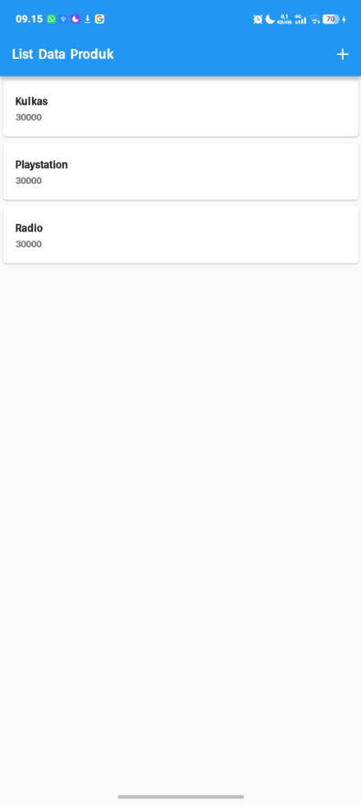
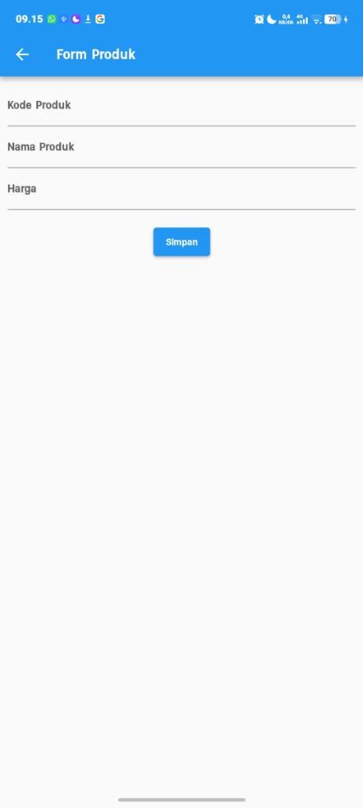

# Laporan Praktikum Pemrograman Mobile

**Nama**        : Putri Isnaini Laksita Utami  
**NIM**         : H1D024078  
**Shift**       : Awal H / Akhir E  
**Praktikum**   : Pemrograman Mobile (Dart & Flutter)

---

## 📝 Tugas Pertemuan 1
**Hari, Tanggal**: Rabu, 21 Oktober 2026  
**Materi**: Instalasi Lingkungan Flutter & Dasar Bahasa Pemrograman Dart

### Penjelasan Teknis
1. **Instalasi & Konfigurasi Environment:**
   - Menyiapkan Java Development Kit (JDK) dan Android Studio beserta Android SDK serta Android Virtual Device (AVD).
   - Mengunduh Flutter SDK dan mendaftarkan direktori `bin` ke *System Environment Variables* (`Path`) agar perintah CLI seperti `flutter doctor`, `flutter create`, dan `flutter run` dapat dijalankan secara global dari terminal maupun IDE.
2. **Sintaksis & Paradigma Pemrograman Dart:**
   - Mempraktikkan dasar bahasa Dart melalui DartPad, meliputi tipe data (`int`, `double`, `String`, `bool`) serta inferensi tipe `var`.
   - Menerapkan operasi matematika dan logika serta struktur kontrol alur program (`if`/`else`, `for`, `while`).
   - Menerapkan modularisasi dengan fungsi, pemrograman berorientasi objek (`class`, konstruktor, method), serta penggunaan pustaka bawaan dengan `import` (`dart:math`).
   - Menangani kesalahan runtime menggunakan blok `try`/`on`/`catch` dan mengeksekusi proses asinkronus menggunakan `Future`, `async`, dan `await`.

### Penjelasan Non Teknis
1. **Kesiapan Infrastruktur & Alat Kerja:** Memastikan seluruh perangkat lunak dan dependensi pengembangan terpasang dengan baik sehingga proses kompilasi aplikasi mobile lintas platform dapat berjalan tanpa kendala teknis.
2. **Pembentukan Pola Pikir Komputasional:** Melatih logika pemrograman terstruktur mulai dari pengelolaan tipe data, alur kendali, hingga pengelompokan kode ke dalam fungsi dan kelas yang rapi.
3. **Efisiensi Pengembangan Lintas Platform:** Memahami bagaimana kombinasi Dart dan Flutter memungkinkan pembangunan aplikasi Android maupun iOS dari satu basis kode (*single codebase*).

**Kesimpulan Praktikum:**  
Pada pertemuan pertama, konfigurasi lingkungan pengembangan Flutter serta pemahaman dasar bahasa pemrograman Dart menjadi fondasi utama sebelum masuk ke pembuatan antarmuka aplikasi. Dengan menguasai tipe data, struktur kontrol, fungsi, OOP, penanganan eksepsi, dan pemrograman asinkronus (`async`/`await`), mahasiswa siap membangun aplikasi Flutter yang terstruktur pada pertemuan-pertemuan berikutnya.

---

## 📝 Tugas Pertemuan 2
**Hari, Tanggal**: Rabu, 28 Oktober 2026  
**Materi**: Pengenalan Framework Flutter, Widget Dasar & Desain UI ([lib/](lib/))

| List Data Produk | Form Produk |
| :---: | :---: |
|  |  |

### Penjelasan Teknis
1. **Inisialisasi & Struktur Project Flutter:**
   - Membuat project Flutter `tokokita` dengan struktur standar (`android/`, `ios/`, `lib/`, `test/`, dan `pubspec.yaml` untuk manajemen dependensi).
2. **StatelessWidget vs StatefulWidget:**
   - Menerapkan `StatelessWidget` untuk komponen statis (`HelloWorld`, `ColumnWidget`, `RowWidget`, dan `ProdukDetail`).
   - Menerapkan `StatefulWidget` untuk komponen interaktif yang menyimpan state (`ProdukForm` dengan `TextEditingController` dan `ProdukPage`).
3. **Tata Letak, Form, & ListView:**
   - Mengatur tata letak vertikal (`Column`) dan horizontal (`Row`), membuat form input produk (`TextField`, `ElevatedButton`), mengirim data ke halaman detail melalui `Navigator.push` + `MaterialPageRoute`, serta menampilkan daftar produk menggunakan `ListView`, `Card`, dan `ListTile`.

### Penjelasan Non Teknis
1. **Pemisahan File & Keterbacaan Kode:** Memisahkan widget dan halaman ke dalam file terpisah di folder `lib/` serta subfolder `lib/ui/` agar kode lebih modular dan mudah dipelihara.
2. **Pengalaman Pengguna Awal:** Menyusun antarmuka Material Design dasar (`Scaffold`, `AppBar`, `Card`) sebagai kerangka awal aplikasi toko.

**Kesimpulan Praktikum:**  
Pada pertemuan kedua, praktikum membahas pembuatan project Flutter serta penyusunan antarmuka dasar menggunakan berbagai widget Material Design (`Scaffold`, `AppBar`, `Column`, `Row`, `TextField`, `ElevatedButton`, `ListView`, `Card`, dan `ListTile`), serta perpindahan halaman sederhana dengan `Navigator.push`.
