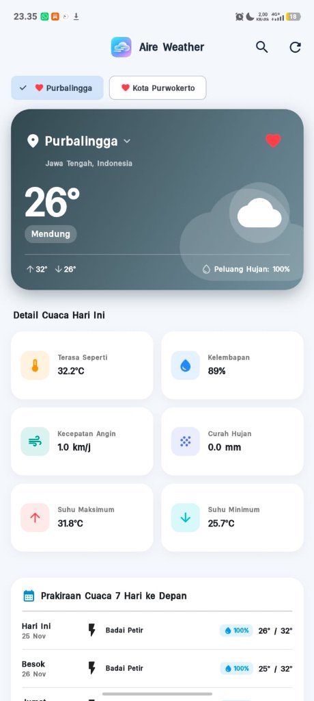
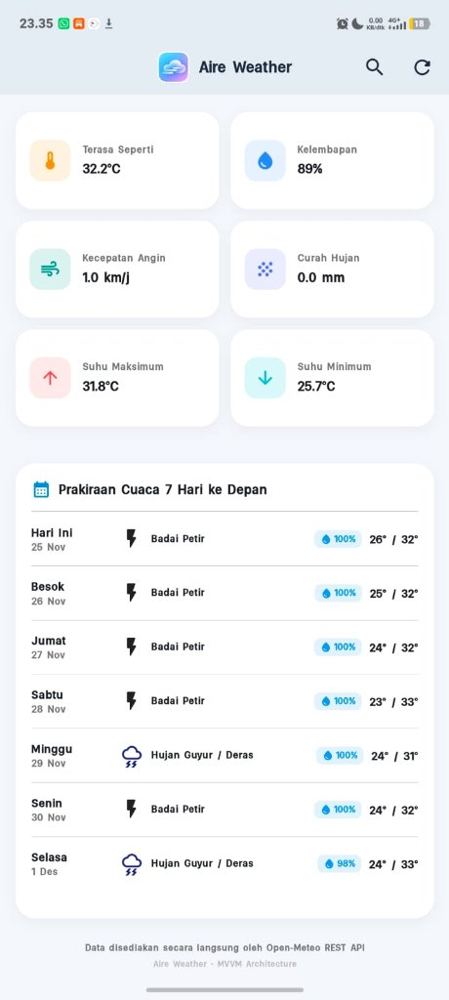
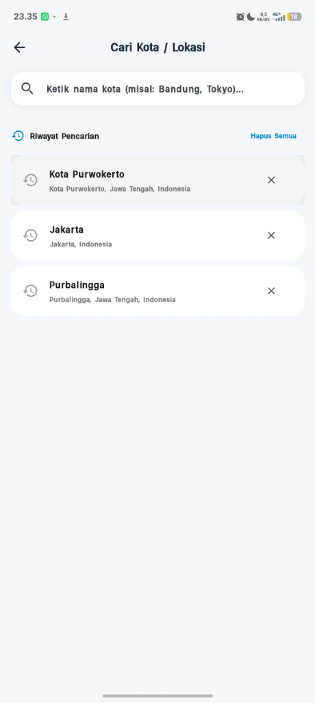

# Aire - Aplikasi Cuaca & Prakiraan Terkini (Responsi Flutter)

<p align="center">
  
  <br>
  <strong>Aplikasi Prakiraan Cuaca Berbasis Flutter & Open-Meteo REST API</strong>
  <br>
  <em>Menggunakan Pola Arsitektur MVVM (Model-View-ViewModel) dan Penyimpanan Lokal (Local Storage)</em>
</p>

---

## 📋 Daftar Isi
1. [Tentang Aplikasi](#-tentang-aplikasi)
2. [Fitur Utama](#-fitur-utama)
3. [Penerapan Arsitektur MVVM](#-penerapan-arsitektur-mvvm)
4. [Implementasi REST API Open-Meteo](#-implementasi-rest-api-open-meteo)
5. [Local Storage (Penyimpanan Lokal)](#-local-storage-penyimpanan-lokal)
6. [Struktur Direktori Proyek](#-struktur-direktori-proyek)
7. [Screenshot Aplikasi](#-screenshot-aplikasi)
8. [Panduan Menjalankan Aplikasi](#-panduan-menjalankan-aplikasi)

---

## 🌦️ Tentang Aplikasi
**Aire** adalah aplikasi ramalan cuaca modern yang dibangun menggunakan framework **Flutter** dengan bahasa pemrograman **Dart**. Aplikasi ini mengambil data meteorologi langsung secara dinamis dan real-time dari **Open-Meteo REST API**.

Aplikasi didesain responsif, clean, dan intuitif menggunakan standar **Material Design 3**, dilengkapi dengan ikon aplikasi kustom dan gradasi warna dinamis yang menyesuaikan dengan kondisi cuaca (cerah, mendung, hujan, badai, dll.).

---

## ✨ Fitur Utama

### 1. Home / Weather Screen
* **Informasi Kota Terpilih**: Menampilkan nama kota, provinsi/negara, dan koordinat.
* **Kondisi Cuaca Terkini**: Menampilkan status kondisi cuaca (Cerah, Berawan, Gerimis, Hujan Lebat, Badai Petir, dll.) dengan ikon WMO yang sesuai.
* **Suhu Saat Ini**: Suhu real-time dalam satuan Celsius (`current.temperature_2m`).
* **Detail Metrik Cuaca**:
  * Suhu yang dirasakan / *apparent temperature* (`current.apparent_temperature`)
  * Kelembapan udara (`current.relative_humidity_2m`)
  * Kecepatan angin (`current.wind_speed_10m`)
  * Curah hujan (`current.precipitation`)
  * Suhu harian maksimum & minimum (`daily.temperature_2m_max`, `daily.temperature_2m_min`)
* **Prakiraan Cuaca 7 Hari**: Menampilkan ramalan cuaca mingguan lengkap dengan persentase peluang hujan (`daily.precipitation_probability_max`).
* **Akses Cepat Favorit**: Tombol chip horizontal di bagian atas untuk berpindah antar kota favorit secara instan.
* **Pull-to-Refresh**: Tarik ke bawah untuk menyegarkan data cuaca dari API.
* **Quick Favorite Toggle**: Tombol hati di hero card untuk langsung menambahkan/menghapus kota dari daftar favorit.

### 2. Search / Location Screen
* **Pencarian Kota Real-time**: Menggunakan Open-Meteo Geocoding API dengan mekanisme debouncing agar hemat kuota dan responsif.
* **Hasil Pencarian Interaktif**: Menampilkan nama lokasi, negara/provinsi, koordinat lintang & bujur.
* **Pemilihan Lokasi**: Sekali sentuh pada hasil pencarian akan langsung memuat data cuaca lokasi tersebut.
* **Daftar Favorit Tersimpan**: Menampilkan seluruh lokasi favorit yang tersimpan pada penyimpanan lokal perangkat.
* **Riwayat Pencarian**: Menyimpan riwayat kota yang pernah dicari dengan opsi hapus satuan atau hapus semua (*Clear All*).

---

## 🏛️ Penerapan Arsitektur MVVM

Aplikasi menerapkan pola arsitektur **Model-View-ViewModel (MVVM)** yang memisahkan logika bisnis, presentasi, dan data model:

```
[ Open-Meteo REST API ]    <-- HTTP GET
          │
          ▼
[ Services & Repositories ] ── WeatherApiService & LocalStorageService
          │
          ▼
[ Models ]                 ── WeatherData, CurrentWeather, DailyForecastItem, LocationModel
          │
          ▼
[ ViewModel (Provider) ]   ── WeatherViewModel (ChangeNotifier)
          │  ▲
          │  │ (Notifies UI & Receives User Events)
          ▼  │
[ Views / Screens ]        ── WeatherScreen, SearchScreen, Reusable Widgets
```

### Penjelasan Komponen:
1. **Model** (`lib/models/`):
   * `weather_model.dart`: Merepresentasikan data cuaca terkini (*current*) dan ramalan harian (*daily forecast*) dari JSON Open-Meteo.
   * `location_model.dart`: Merepresentasikan entitas lokasi kota dari Geocoding API, dilengkapi enkoder/dekoder JSON untuk penyimpanan lokal.
2. **ViewModel** (`lib/viewmodels/`):
   * `weather_viewmodel.dart`: Mengelola state aplikasi (kondisi *initial*, *loading*, *success*, *empty*, *error*), memanggil *Service*, mengelola favorit, dan memicu pembaruan UI melalui `notifyListeners()`.
3. **View** (`lib/views/`):
   * `weather_screen.dart` & `search_screen.dart`: Berisi tampilan antarmuka (UI). Hanya bertugas menampilkan data dari ViewModel dan meneruskan interaksi pengguna ke ViewModel.
4. **Service** (`lib/services/`):
   * `weather_api_service.dart`: Bertanggung jawab atas komunikasi jaringan HTTP GET ke Open-Meteo API.
   * `local_storage_service.dart`: Bertanggung jawab atas persistensi data ke `SharedPreferences`.

---

## 🌐 Implementasi REST API Open-Meteo

Seluruh data cuaca dan pencarian kota diambil langsung secara dinamis melalui REST API:

1. **Geocoding API (Pencarian Kota)**:
   * **Endpoint**: `https://geocoding-api.open-meteo.com/v1/search`
   * **Parameter**: `name={query}&count=10&language=id&format=json`
2. **Weather Forecast API**:
   * **Endpoint**: `https://api.open-meteo.com/v1/forecast`
   * **Parameter Utama**:
     * `latitude` & `longitude`: Koordinat lokasi kota.
     * `current`: `temperature_2m,relative_humidity_2m,apparent_temperature,precipitation,weather_code,wind_speed_10m`
     * `daily`: `weather_code,temperature_2m_max,temperature_2m_min,precipitation_probability_max`
     * `timezone`: `auto`

---

## 💾 Local Storage (Penyimpanan Lokal)
Menggunakan package **`shared_preferences`** untuk menyimpan:
1. **Daftar Lokasi Favorit**: Daftar kota yang ditandai sebagai favorit oleh pengguna, dimuat otomatis saat aplikasi dibuka.
2. **Riwayat Pencarian**: Daftar kota yang terakhir kali dicari dan dipilih.
3. **Lokasi Terakhir**: Menyimpan lokasi terakhir yang sedang dibuka sehingga pengguna langsung melihat cuaca kota tersebut saat membuka kembali aplikasi.

---

## 📂 Struktur Direktori Proyek

```text
lib/
├── main.dart                          # Titik masuk utama aplikasi & inisialisasi Provider
├── models/
│   ├── location_model.dart            # Model data kota & koordinat
│   └── weather_model.dart             # Model data cuaca Open-Meteo
├── services/
│   ├── local_storage_service.dart     # Service SharedPreferences
│   └── weather_api_service.dart       # Service HTTP Client Open-Meteo
├── utils/
│   ├── app_theme.dart                 # Konfigurasi Tema Material 3
│   └── weather_code_mapper.dart       # Mapping kode WMO ke icon & deskripsi
├── viewmodels/
│   └── weather_viewmodel.dart         # Pengelola State & Business Logic (MVVM)
└── views/
    ├── screens/
    │   ├── search_screen.dart         # Layar Pencarian & Favorit
    │   └── weather_screen.dart        # Layar Utama Cuaca
    └── widgets/
        ├── daily_forecast_widget.dart # Widget ramalan 7 hari
        ├── weather_header_card.dart   # Widget Hero Banner Cuaca
        └── weather_info_card.dart     # Widget metrik detail cuaca
```

---

## 📸 Screenshot Aplikasi

| Home Screen (Atas) | Home Screen (Prakiraan 7 Hari) | Search & History Screen |
| :---: | :---: | :---: |
|  |  |  |

---

## 🚀 Panduan Menjalankan Aplikasi

1. **Clone repository ini**:
   ```bash
   git clone <URL_REPOSITORY_ANDA>
   cd aire
   ```

2. **Unduh dependencies**:
   ```bash
   flutter pub get
   ```

3. **Jalankan pengujian (Unit & Widget Test)**:
   ```bash
   flutter test
   ```

4. **Jalankan aplikasi**:
   ```bash
   flutter run
   ```
